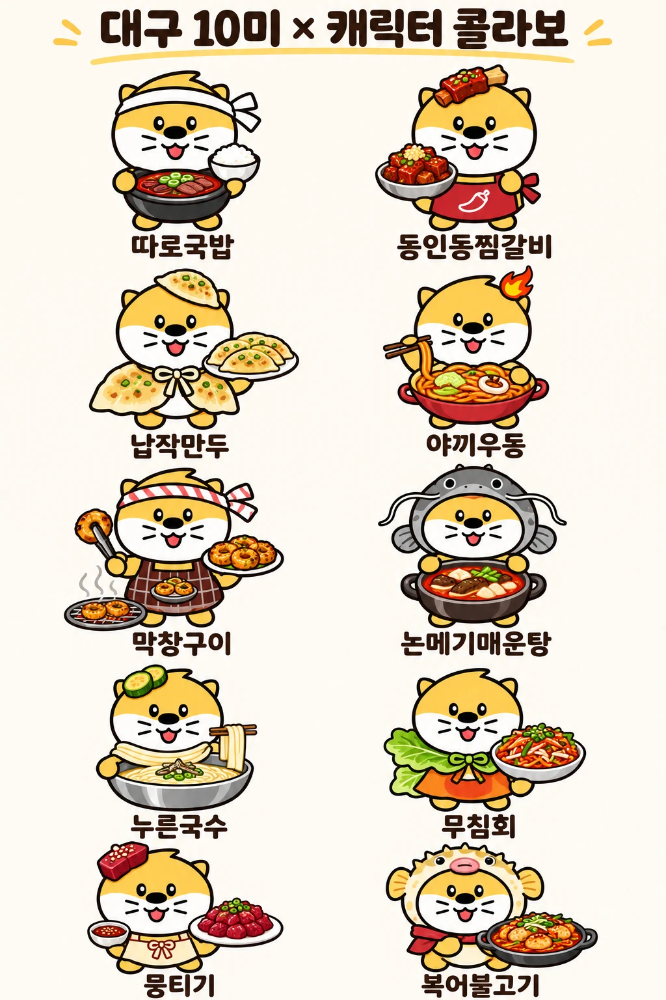

# 🍜 대구 10미 × 캐릭터 콜라보

대구를 대표하는 음식 **대구 10미(味)** 를 귀여운 노란 캐릭터와 함께 소개하는 콜라보 일러스트 프로젝트입니다.
각 캐릭터는 음식의 특징을 살린 소품과 의상을 착용하고 있습니다.

<p align="center">
  
</p>

---

## 📋 대구 10미 목록

| No. | 음식 | 소개 | 캐릭터 포인트 |
|:---:|------|------|---------------|
| 1 | **따로국밥** | 밥과 국을 따로 내는 대구식 소고기 선짓국밥 | 흰 머리띠를 두르고 뚝배기와 공깃밥을 따로 든 모습 |
| 2 | **동인동찜갈비** | 양은 냄비에 마늘·고춧가루 양념으로 매콤하게 쪄낸 소갈비 | 머리 위 갈비, 고추 그림 빨간 앞치마 |
| 3 | **납작만두** | 얇고 납작하게 빚어 구워 먹는 대구 분식의 대표 | 만두 모자와 만두 망토 |
| 4 | **야끼우동** | 해물과 채소를 고춧가루로 볶아낸 매운 중화식 볶음우동 | 머리 위 불꽃, 젓가락으로 면 들기 |
| 5 | **막창구이** | 소·돼지 막창을 숯불에 구워 된장 소스에 찍어 먹는 대구 명물 | 줄무늬 머리띠, 체크 앞치마, 집게와 석쇠 |
| 6 | **논메기매운탕** | 논에서 기른 메기로 끓인 얼큰한 매운탕 | 메기 탈을 쓴 모습 |
| 7 | **누른국수** | 밀가루 반죽을 홍두깨로 밀어 칼로 썬 경상도식 칼국수 | 머리 위 애호박 고명, 면을 들어올리는 모습 |
| 8 | **무침회** | 오징어·소라 등을 채소와 함께 매콤새콤하게 무친 회무침 | 상추 망토 |
| 9 | **뭉티기** | 소 우둔살을 뭉텅뭉텅 썰어 양념장에 찍어 먹는 생고기 | 머리 위 생고기, 리본 앞치마 |
| 10 | **복어불고기** | 복어살을 콩나물과 함께 매콤하게 볶아낸 요리 | 복어 탈과 빨간 스카프 |

---

## 🎨 캐릭터 콘셉트

- **기본 컬러**: 노랑 + 흰색 투톤
- **표정**: 둥근 눈, 수염, 활짝 웃는 입
- **콘셉트**: 음식마다 어울리는 머리 장식·의상·소품을 더해 음식의 개성을 표현

## 💡 활용 아이디어

- 대구 관광 홍보물 / 굿즈 (스티커, 엽서, 키링)
- 맛집 지도 및 스탬프 투어
- SNS 이모티콘 시리즈

---

## 📁 폴더 구조

```
.
├── README.md
└── images/
    └── daegu-10mi-collab.webp
```
