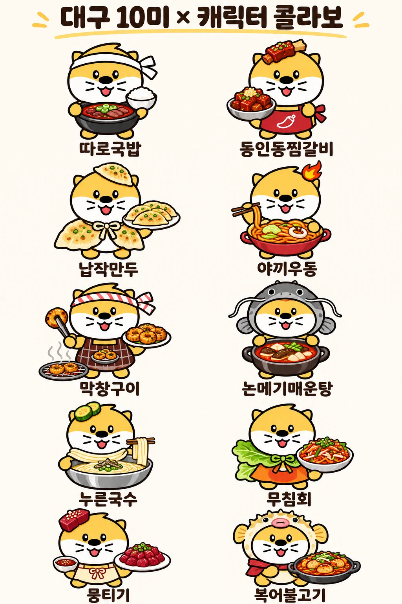

# 🦦 대구를 입은 수달 마스코트

> **TREGENT 팀 프로젝트** · 2026.11.3 (화)
> 도달쑤 베리에이션으로 대구의 골목·시장·맛을 알리는 캐릭터 프로젝트

<p align="center">
  
</p>

📎 발표 파일 내려받기: [TREGENT-팀-프로젝트.pptx](files/TREGENT-팀-프로젝트.pptx)

---

## 목차

1. [주제 선정](#1-주제-선정)
2. [시장 조사 핵심](#2-시장-조사-핵심)
3. [도달쑤 현황](#3-도달쑤-현황)
4. [국내 지역 캐릭터 사례](#4-국내-지역-캐릭터-사례)
5. [추천 순서와 초기 고객](#5-추천-순서와-초기-고객)
6. [고려 사항](#6-고려-사항)
7. [캐릭터 원형과 베리에이션](#7-캐릭터-원형과-베리에이션)
8. [필요한 에이전트](#8-필요한-에이전트)
9. [가장 큰 위험: 계약](#9-가장-큰-위험-계약)
10. [콜라보 후보](#10-콜라보-후보)
11. [지금 할 일](#11-지금-할-일)

---

## 1. 주제 선정

**대구의 골목·시장 특성을 입힌 캐릭터 마스코트를 만들고, 단편 웹툰으로 대구의 특색을 알린다.**

- 참고: 산리오 지역 특산물, 아프로켄

---

## 2. 시장 조사 핵심

| 질문 | 답 |
|---|---|
| **무엇부터?** | 대구 공감 인스타툰·숏폼에 고정 캐릭터를 붙여 팬부터 모으기 |
| **그다음은?** | 약령시·향토음식으로 라인업 확장 → 이모티콘·키링으로 소량 판매 테스트 |
| **누구를 참고?** | 지역: 뚜비·꿈돌이·하모·고양고양이 / 일본: 바리상·군마짱 / 사업: 망그러진 곰·SAMG |
| **기대 매출은?** | 낮게 잡기. 뚜비 굿즈가 18개월 약 2.18억 원, 손익을 공개한 로컬 캐릭터는 못 찾음 |
| **가장 큰 위험은?** | 계약. 구름빵·검정고무신·히코냥 모두 권리 문제 |
| **누구와 협업?** | 스타보다 지역 창작자, 대구FC, 페가수스, 로컬 빵집, iM뱅크 |

---

## 3. 도달쑤 현황


- **지위:** 대구시 대표 캐릭터로 사용 중. 단, 공식 지정 문서는 못 찾음 (2022년 대구MBC는 시 입장으로 "공식 아님" 보도)
- **하모와 비교 (2021 이모티콘 배포, 간접 비교):** 하모 5만 개 13분 소진 · 달쑤 4.5만 개 1시간 30분
- ⚠️ **주의:** 수달은 도달쑤와 진주 하모가 모두 사용 → 원형을 쓰려면 대구시에 상업적 이용 가능 여부 확인

<br clear="right">

---

## 4. 국내 지역 캐릭터 사례

| 캐릭터 | 대표 수치 | 배울 점 |
|---|---|---|
| **수성구 뚜비** | 굿즈 18개월 2.18억 원 `미검증` | 대구권 현실 기준, 공모전으로 창작자 참여 |
| **대전 꿈돌이** | 공공 판매처 약 35억 원 (17개월) `시 발표` | 식품이 물량을 만든다 |
| **진주 하모** | 이모티콘 5만 개 13분 `시 발표` | 무료 이모티콘으로 구독자 확보 |
| **고양 고양이** | 복귀 영상 2개월 260만 회 `시 발표` | 시민 애착이 자산, 단 정책에 따라 끊김 |

> `미검증` = 검색 요약으로만 확인 · `시 발표` = 지자체 수치(독립 검증 없음)

---

## 5. 추천 순서와 초기 고객

```
인스타툰·숏폼  →  이모티콘  →  키링 등 소형 굿즈  →  더현대 대구·야시장·동성로 판매
```

| 대구 외국인 방문율 (잠정) | 부산 외국인 방문율 |
|:---:|:---:|
| **0.7%** | **18.4%** |

**초기 고객은 외국인 관광객보다 대구 출향민과 2030** (2026년 2분기 기준)

---

## 6. 고려 사항

| 항목 | 내용 |
|---|---|
| ⭐ **차별성** | 뻔하지 않게, 새로움을 주는 캐릭터 |
| 🏠 **콘텐츠화** | 진짜 대구의 모습을 배경으로, 성지순례처럼 찾아갈 수 있게 |
| 🔍 **테스트 → 추천** | 테스트로 나와 맞는 마스코트를 찾고, 결과에 맞는 관광지 추천 (자차 없이도 가능하게) |
| 👥 **콜라보 (선택)** | 유튜버, 지역 축제 상인과의 콜라보는 일단 더미로, 가능하면 추가 제작 |

---

## 7. 캐릭터 원형과 베리에이션

**원형: 대구광역시 수달 마스코트 '도달쑤'**

`원형 그대로` + `지역 소품·의상` = `베리에이션`

> **예시 입력**
> "대구광역시 북성로 공구골목의 특성으로, 렌치·볼트 같은 것을 장난스레 만지거나 옷이나 액세서리로 만들어 착용하고 있는 캐릭터 마스코트를 만들어줘."

### 베리에이션 예시: 대구 10미 × 캐릭터 콜라보

<p align="center">
  
</p>

따로국밥 · 동인동찜갈비 · 납작만두 · 야끼우동 · 막창구이 · 논메기매운탕 · 누른국수 · 무침회 · 뭉티기 · 복어불고기

같은 얼굴과 체형에 음식별 소품·의상만 바꿔, 생김새를 일정하게 유지

---

## 8. 필요한 에이전트

| # | 에이전트 | 역할 | 주의점 / 선택 사항 |
|:---:|---|---|---|
| 1 | **캐릭터 생성** | 도달쑤 기반, 입력에 맞는 마스코트 베리에이션 산출 | 예: 북성로 공구골목 캐릭터 |
| 2 | **캐릭터 설정** | 특성, 캐릭터 설명, 에피소드(프롬프트) 생성 | ⚠️ 생김새를 일정하게 유지 |
| 3 | **관광지 추천** | 테스트 결과와 비슷한 캐릭터가 관광지 추천 | 한국관광공사 TourAPI + 대중교통 길찾기 API (자차 없이) |
| 4 | **굿즈 도안** | 실제 굿즈 규격을 참고해 도안 제작 | 필요하면 샘플 몇 개 출력 |

> (선택) 할 수 있으면 웹페이지까지 제작

---

## 9. 가장 큰 위험: 계약

**권리는 계약서에서 먼저 정한다**

| 사례 | 무슨 일이 있었나 | 우리가 할 일 |
|---|---|---|
| 구름빵 | 작가 패소 확정 (2020) | 포괄 양도 피하기. 매체·품목·지역·기간 명시 |
| 검정고무신 | 항소심 유족 승소 후 확정 (2026) | 수익 산식, 정산 주기, 해지 조건 명시 |
| 히코냥 | 시와 원작자의 권리 분쟁 `미검증` | 공공 의뢰작도 저작권·상표 귀속 문서화 |
| **AI 생성 캐릭터** | 사람이 기여한 부분만 등록 효력 | **시안·프롬프트·수정 이력 보관** |

> 법률 자문 아님. 권리 조항은 변호사 검토

---

## 10. 콜라보 후보

**스타보다 지역 파트너부터**

| 후보 | 접근성 | 방식 |
|---|:---:|---|
| 지역 창작자 | 상 | 제우준·대구툰 등과 공동 연재, 교차 출연 |
| 동성로 상권 | 상 | 팝업으로 현장 검증. 일회성 위험 |
| 대구FC | 중상 | 이벤트, 이모티콘. 지역 작가 웹툰 전례 |
| 페가수스 | 중상 | 한국가스공사 농구단에 첫 캐릭터 파트너 제안 |
| 로컬 빵집 | 중상 | 패키지, 스티커. 성사 사례 없는 가설 |
| iM뱅크 | 중 | 카드·통장 이벤트용 IP 공급 (마케팅 목적) |

> 접근성 등급은 조사자 판단

---

## 11. 지금 할 일

1. **대구디지털혁신진흥원(DIP)** 에 2027년 지원 사업 공고 문의
2. **대구시에 도달쑤 문의:** 공식 지정 여부, 상업적 이용 가능 여부
3. **KIPRIS 상표 조회:** 치맥, 납작만두, 대프리카, 달구벌
4. **제안 시점 결정:** 11월 22일 대구시 슬로건 조사 종료, 대구FC 승격 결과 확인 후
5. **첫 계약서 준비:** 권리 조항은 변호사 검토

> 2026년 공고는 확인된 범위에서 모두 마감

---

<p align="center">
  <b>진짜 대구를 배경으로, 성지순례처럼</b><br>
  도달쑤 베리에이션으로 대구의 골목·시장·맛을 알린다<br><br>
  감사합니다 · TREGENT
</p>

---

*시장 조사 출처: 대구 캐릭터 산업 진출 전략 요약 (기준일 2026.11.3)*
