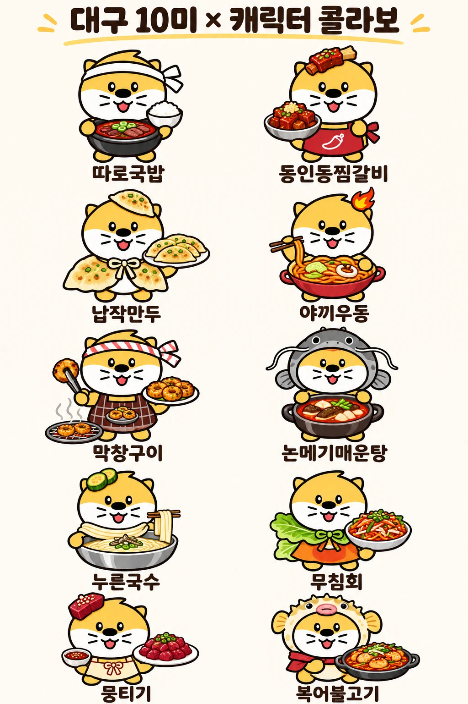

# 🦦 도달쑤 캐릭터 모음

대구광역시 수달 마스코트 **도달쑤**를 원형으로 만든 캐릭터 이미지 모음입니다.
얼굴과 체형은 그대로 두고, 지역 특성에 맞춘 소품과 의상만 바꿔 생김새를 일정하게 유지합니다.

📊 관련 문서: [발표자료.md](발표자료.md) · [README.md](README.md)

---

## 1. 기본 도달쑤

  

| 특징 | 내용 |
|---|---|
| 컬러 | 노랑 + 흰색 투톤 |
| 얼굴 | 둥근 눈, 큰 코, 수염, 혀를 내민 웃는 입 |
| 몸 | 흰 배, 짧은 팔다리, 작은 꼬리 |
| 머리 | 위쪽 삐침 털, 양옆 둥근 귀 |

---

## 2. 머리띠 · 초록 한복 도달쑤

  

| 특징 | 내용 |
|---|---|
| 머리 | 초록 잎 무늬가 들어간 크림색 머리띠 |
| 의상 | 초록 한복 겉옷, 진초록 허리끈, 옷자락에 잎 무늬 |
| 자세 | 두 손을 모은 공손한 인사 자세 |

---

## 3. 대구 10미 × 캐릭터 콜라보

  

| No. | 음식 | 캐릭터 포인트 |
|:---:|---|---|
| 1 | 따로국밥 | 흰 머리띠, 뚝배기와 공깃밥 |
| 2 | 동인동찜갈비 | 머리 위 갈비, 고추 그림 빨간 앞치마 |
| 3 | 납작만두 | 만두 모자와 만두 망토 |
| 4 | 야끼우동 | 머리 위 불꽃, 젓가락으로 면 들기 |
| 5 | 막창구이 | 줄무늬 머리띠, 체크 앞치마, 집게와 석쇠 |
| 6 | 논메기매운탕 | 메기 탈 |
| 7 | 누른국수 | 머리 위 애호박 고명 |
| 8 | 무침회 | 상추 망토 |
| 9 | 뭉티기 | 머리 위 생고기, 리본 앞치마 |
| 10 | 복어불고기 | 복어 탈과 빨간 스카프 |

---

## 📁 이미지 파일

| 파일 | 설명 |
|---|---|
| [`images/dodalssu-basic.png`](images/dodalssu-basic.png) | 기본 도달쑤 |
| [`images/dodalssu-hanbok.webp`](images/dodalssu-hanbok.webp) | 머리띠 · 초록 한복 도달쑤 |
| [`images/dodalssu-cover.png`](images/dodalssu-cover.png) | 발표 표지용 (머리띠 · 초록 한복, 투명 배경) |
| [`images/daegu-10mi-collab.webp`](images/daegu-10mi-collab.webp) | 대구 10미 × 캐릭터 콜라보 |

> ⚠️ 도달쑤를 원형으로 쓰는 만큼, 외부 공개나 상업적 이용 전에는 대구시에 이용 가능 여부를 확인해야 합니다.
